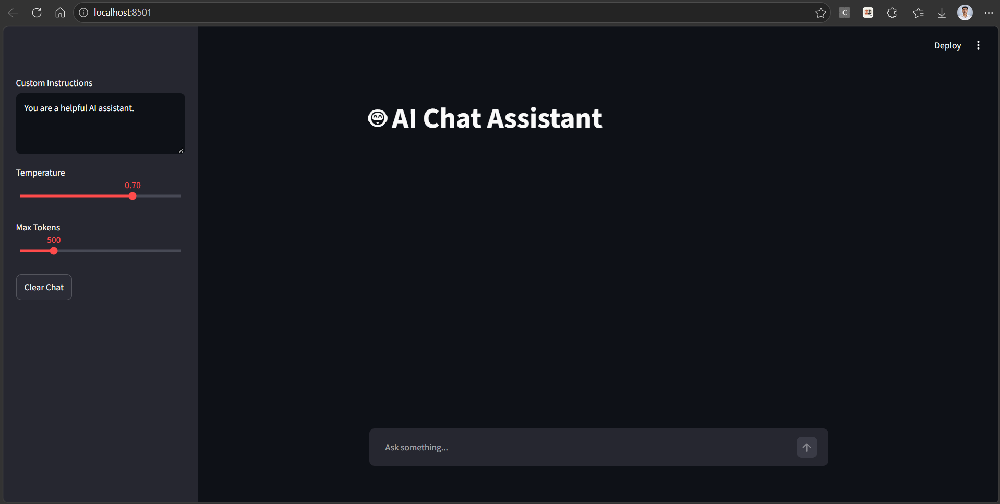

# Module 3: Streamlit AI Chat Assistant

An interactive conversational AI web application built with **Streamlit**, **LangChain**, and **Groq** (`ChatGroq`). The assistant features conversational memory, custom system persona instructions, dynamic hyperparameter controls, and structured response parsing using Pydantic.

---

## 📸 Application Preview



---

## 📌 Features

- **Interactive Web Interface**: Clean and responsive chat UI powered by Streamlit (`st.chat_message`, `st.chat_input`).
- **Conversational Memory**: Maintains multi-turn context throughout the chat session.
- **Customizable System Instructions**: Configurable system persona and prompt behavior via the sidebar.
- **Dynamic Parameter Tuning**: Sliders for `temperature` (creativity/randomness) and `max_tokens` (response length).
- **Structured Pydantic Output**: Uses `PydanticOutputParser` to enforce response schema with a direct answer and concise bulleted key points.
- **Groq Acceleration**: High-speed inference using Groq LLMs (`openai/gpt-oss-20b`).
- **Usage Metrics & Controls**: Live token usage estimation and one-click chat history reset.

---

## ⚙️ Prerequisites & Setup

### 1. Environment Setup

Create and activate a Python virtual environment (Python 3.10+ recommended):

```bash
python -m venv venv
# On Windows:
venv\Scripts\activate
# On Linux/macOS:
source venv/bin/activate
```

### 2. Install Dependencies

Install the required packages using [`requirements.txt`](file:///f:/Intership/GenAI-Codomax/Module%203/requirements.txt):

```bash
pip install -r requirements.txt
```

### 3. API Key Configuration

Create a `.env` file in the `Module 3` directory (or populate the existing one) with your Groq API key:

```env
GROQ_API_KEY=your_groq_api_key_here
```

---

## 🚀 Running the Application

Launch the Streamlit app with:

```bash
streamlit run app.py
```

Once running, the application will open automatically in your default browser at `http://localhost:8501`.

---

## 📁 File Structure

```text
Module 3/
├── .env                # Environment variables (GROQ_API_KEY)
├── app.py              # Main Streamlit application
├── image.png           # Application UI preview screenshot
├── README.md           # Module documentation
└── requirements.txt    # Project dependencies
```
