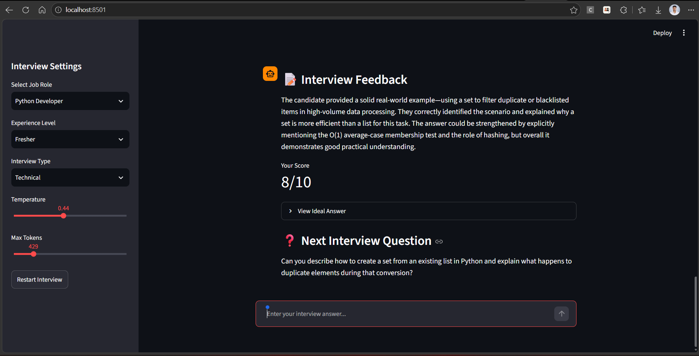

# Module 6: Streamlit AI Interview Assistant

An interactive conversational AI interview simulator built with **Streamlit**, **LangChain**, and **Groq** (`ChatGroq`). The assistant acts as a professional technical and HR interviewer, assessing candidate responses, scoring answers out of 10, providing constructive feedback and suggested answers, and asking follow-up questions.

---

## 📸 Application Preview



---

## 📌 Features

- **Role & Experience Customization**: Select target job roles (*Python Developer, AI Engineer, Data Scientist, Java Developer, GenAI Developer*) and experience levels (*Fresher, Intermediate, Experienced*).
- **Flexible Interview Formats**: Supports Technical, HR, Coding, or Mixed interview styles.
- **Structured Pydantic Evaluation**: Uses `PydanticOutputParser` to enforce structured feedback per answer:
  - Constructive feedback
  - Quantitative score (out of 10)
  - Ideal suggested answer
  - Contextual follow-up question
- **Interactive Streamlit Interface**: Real-time feedback cards, score metric display, expandable ideal answers, and chat history.
- **Model Tuning**: Real-time sidebar sliders for `temperature` and `max_tokens`.
- **Groq Inference**: High-speed conversational responses via `ChatGroq` (`openai/gpt-oss-20b`).

---

## ⚙️ Prerequisites & Setup

### 1. Environment Setup

Create and activate a Python virtual environment (Python 3.10+ recommended):

```bash
python -m venv venv
# On Windows:
venv\Scripts\activate
# On Linux/macOS:
source venv/bin/activate
```

### 2. Install Dependencies

Install the required packages using [`requirements.txt`](file:///f:/Intership/GenAI-Codomax/Module%206/requirements.txt):

```bash
pip install -r requirements.txt
```

### 3. API Key Configuration

Create or update the `.env` file in the `Module 6` directory with your Groq API key:

```env
GROQ_API_KEY=your_groq_api_key_here
```

---

## 🚀 Running the Application

Launch the Streamlit app:

```bash
streamlit run app.py
```

The application will start and open automatically in your browser at `http://localhost:8501`.

---

## 📁 File Structure

```text
Module 6/
├── .env                # Environment variables (GROQ_API_KEY)
├── app.py              # Main Streamlit interview assistant app
├── image.png           # Application UI preview screenshot
├── README.md           # Module documentation
└── requirements.txt    # Project dependencies
```
